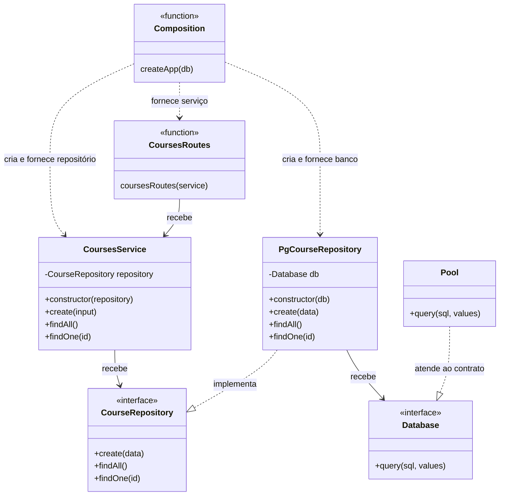
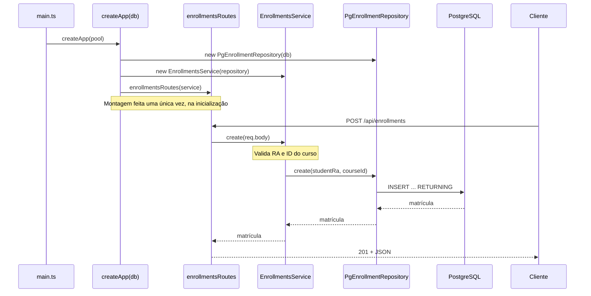

<div align="center">

# 💉 Injeção de Dependência na Prática

**API REST de alunos, cursos e matrículas refatorada para receber suas dependências de fora, sem nenhum framework.**


Atividade da disciplina **Desenvolvimento Web II**, FATEC (DSM)

</div>

---

## 📌 Sobre o projeto

O projeto parte de uma API em que apenas o módulo de **alunos** (`students`) usava injeção de dependência. Os módulos de **cursos** (`courses`) e **matrículas** (`enrollments`) criavam as próprias dependências com `new` e acessavam o banco por um `pool` importado diretamente.

Este repositório traz a refatoração completa: **os três módulos agora seguem o mesmo padrão**. Cada camada recebe aquilo de que precisa por parâmetro, e toda a montagem dos objetos fica concentrada em um único lugar, a **raiz de composição** em [`app.ts`](server/src/app.ts).

> Os endpoints, os corpos JSON, as validações, os códigos HTTP e as consultas SQL não mudaram. Só mudou **quem cria quem**.

---

## 🧠 A ideia em 30 segundos

Uma **dependência** é um objeto de que outro objeto precisa para trabalhar. **Injetar** é entregar essa dependência pronta, em vez de deixar o objeto criá-la.

<table>
<tr>
<th>❌ Antes: o serviço cria o repositório</th>
<th>✅ Depois: o serviço recebe o repositório</th>
</tr>
<tr>
<td>

```ts
export class CoursesService {
  private readonly repository =
    new PgCourseRepository();
}

export class PgCourseRepository {
  async findAll() {
    return (await pool.query(...)).rows;
  }
}
```

</td>
<td>

```ts
export class CoursesService {
  constructor(
    private readonly repository: CourseRepository,
  ) {}
}

export class PgCourseRepository
  implements CourseRepository {
  constructor(private readonly db: Database) {}
}
```

</td>
</tr>
</table>

O serviço passa a depender de um **contrato** (`CourseRepository`), e não de uma classe concreta. Com isso, dá para trocar o PostgreSQL por outra implementação, como um repositório em memória para testes, **sem alterar uma linha do serviço**.

---

## 🔧 O que foi feito

| Camada | Antes | Depois |
| --- | --- | --- |
| **Repositório** | Importava o `pool` direto de `connection.ts` | Recebe `Database` pelo construtor e implementa `CourseRepository` / `EnrollmentRepository` |
| **Serviço** | Fazia `new PgCourseRepository()` internamente | Recebe o contrato do repositório pelo construtor |
| **Rotas** | Faziam `new CoursesService()` internamente | Recebem o serviço por parâmetro: `coursesRoutes(service)` |
| **`app.ts`** | Chamava `coursesRoutes()` sem dependências | Monta a cadeia `db → repositório → serviço → rotas` |

Arquivos alterados:

- [`courses.repository.ts`](server/src/modules/courses/courses.repository.ts), [`courses.service.ts`](server/src/modules/courses/courses.service.ts), [`courses.routes.ts`](server/src/modules/courses/courses.routes.ts)
- [`enrollments.repository.ts`](server/src/modules/enrollments/enrollments.repository.ts), [`enrollments.service.ts`](server/src/modules/enrollments/enrollments.service.ts), [`enrollments.routes.ts`](server/src/modules/enrollments/enrollments.routes.ts)
- [`app.ts`](server/src/app.ts)

### A raiz de composição

Todo `new` da aplicação vive aqui. É o único lugar que conhece as classes concretas:

```ts
export function createApp(db: Database) {
  // ...
  const studentRepository = new PgStudentRepository(db);
  const studentsService = new StudentsService(studentRepository);

  const courseRepository = new PgCourseRepository(db);
  const coursesService = new CoursesService(courseRepository);

  const enrollmentRepository = new PgEnrollmentRepository(db);
  const enrollmentsService = new EnrollmentsService(enrollmentRepository);

  app.use("/api/students", studentsRoutes(studentsService));
  app.use("/api/courses", coursesRoutes(coursesService));
  app.use("/api/enrollments", enrollmentsRoutes(enrollmentsService));
}
```

E quem fornece o banco é o [`main.ts`](server/src/main.ts): `createApp(pool)`.

---

## 🗺️ Arquitetura depois da refatoração

Os três módulos agora têm exatamente o mesmo formato. Abaixo, o diagrama do módulo de cursos (matrículas é idêntico):



### Fluxo de inicialização e de uma requisição



---

## 🚀 Como executar

**Pré-requisitos:** [Docker](https://www.docker.com/) e Docker Compose.

```bash
# 1. Clone o repositório
git clone https://github.com/DeaTuribio/Injecao-de-dependencia_WEB.git
cd Injecao-de-dependencia_WEB

# 2. Crie o .env (somente se ainda não existir)
cp .env.example .env

# 3. Suba tudo
docker compose up -d --build
```

| Recurso | Endereço |
| --- | --- |
| 🖥️ Interface web | http://localhost:8080 |
| 🔌 API | http://localhost:3002 |
| 🐘 PostgreSQL | `localhost:5433` |

Na primeira inicialização, o banco executa [`init.sql`](database/init.sql) e [`seed.sql`](database/seed.sql), com 3 alunos e 39 cursos de exemplo.

Para encerrar:

```bash
docker compose down
```

### Verificar os tipos

```bash
cd server
npm install
npm run typecheck
```

---

## 📡 Endpoints

### Alunos: `/api/students`

| Método | Rota | Descrição |
| --- | --- | --- |
| `GET` | `/api/students` | Lista os alunos |
| `POST` | `/api/students` | Cadastra um aluno: `{ "ra": 258004, "name": "Fulano" }` |
| `GET` | `/api/students/:ra` | Busca um aluno pelo RA |

### Cursos: `/api/courses`

| Método | Rota | Descrição |
| --- | --- | --- |
| `GET` | `/api/courses` | Lista os cursos |
| `POST` | `/api/courses` | Cadastra um curso: `{ "name": "Desenvolvimento Web IV" }` |
| `GET` | `/api/courses/:id` | Busca um curso pelo ID |

### Matrículas: `/api/enrollments`

| Método | Rota | Descrição |
| --- | --- | --- |
| `GET` | `/api/enrollments` | Lista as matrículas |
| `POST` | `/api/enrollments` | Matricula um aluno: `{ "studentRa": 258001, "courseId": 8 }` |
| `GET` | `/api/enrollments/student/:studentRa/course/:courseId` | Busca uma matrícula |

### Respostas de erro

Todos os erros seguem o mesmo formato JSON:

```json
{ "statusCode": 404, "message": "Curso com ID 99 não encontrado.", "error": "Not Found" }
```

| Código | Quando acontece |
| --- | --- |
| `400` | Dados inválidos (nome curto, RA não numérico, JSON malformado) |
| `404` | Registro não encontrado, ou aluno/curso inexistente na matrícula |
| `409` | Duplicidade (RA repetido, curso com mesmo nome, matrícula repetida) |

---

## 📂 Estrutura

```text
.
├── compose.yml              # Orquestra banco, API e front
├── database/                # init.sql (tabelas) e seed.sql (dados iniciais)
├── front/                   # Interface web servida pelo Nginx
└── server/
    └── src/
        ├── main.ts          # Cria o pool e inicia o servidor
        ├── app.ts           # ⭐ Raiz de composição: monta todas as dependências
        ├── database/
        │   └── connection.ts   # pool + contrato Database
        └── modules/
            ├── students/       # repository · service · routes
            ├── courses/        # repository · service · routes
            └── enrollments/    # repository · service · routes
```

---

## ✅ Critérios atendidos

- [x] Serviços de cursos e matrículas recebem **contratos** de repositório e não instanciam classes concretas
- [x] Repositórios recebem `Database` e **não importam o `pool`**
- [x] Funções de rotas recebem os serviços por parâmetro
- [x] Toda a montagem acontece em `app.ts`, usando o mesmo `db`
- [x] `npm run typecheck` passa sem erros
- [x] Todas as rotas foram testadas e mantêm o comportamento original (200/201/400/404/409)

---

<div align="center">

Projeto base fornecido pelo professor em [arleysouza/webII-2026-2-dependencia](https://github.com/arleysouza/webII-2026-2-dependencia) · Refatoração por [@DeaTuribio](https://github.com/DeaTuribio)

</div>
